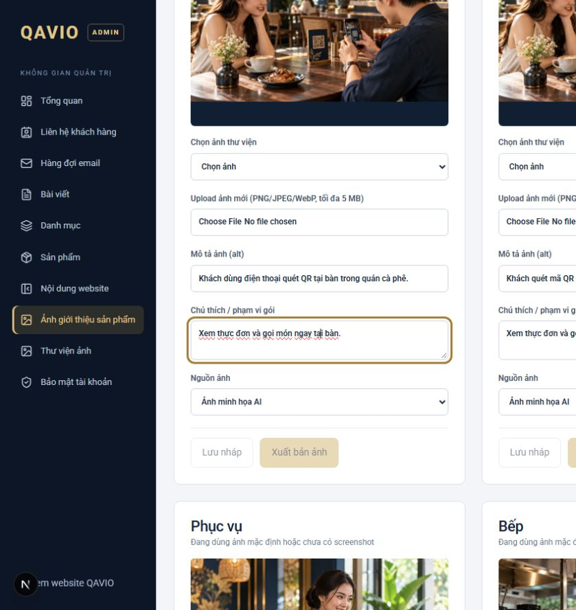
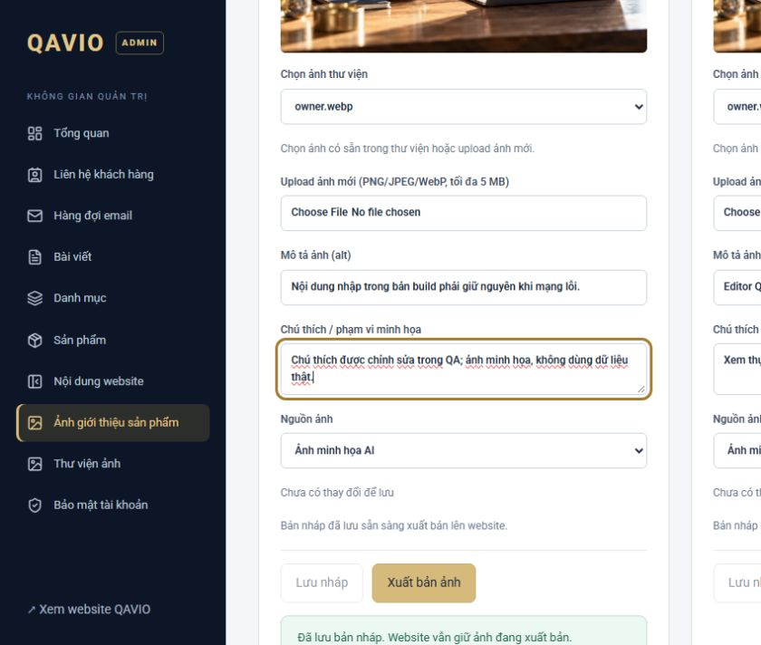

# Kiểm tra Lưu nháp / Xuất bản ảnh — 28/10/2026

## Kết luận và phạm vi

Đã xác định các điều kiện khóa trong source, tái hiện lỗi ảnh mặc định trên QA và hoàn thiện bản sửa local. **Ngày 28/10/2026, chủ dự án đã duyệt commit/push bản sửa này. Chưa deploy. Không upload/xuất bản bất kỳ ảnh nào trên production.**

Browser production mở `https://qavio.site/admin/visuals` nhưng chuyển về `/admin/login`. Đã đề nghị chủ dự án đăng nhập trong trình duyệt kết nối; đến lúc lập báo cáo chưa có phiên đăng nhập. Vì vậy chưa xác nhận quyền, slot, bản nháp hay lỗi API trong chính phiên production của chủ dự án. Không coi kết quả QA là bằng chứng đã thao tác thành công trên production.

## 1. Nguyên nhân đã chứng minh

Component: `src/components/admin/visuals.tsx`, `VisualCard`.

| Nút / trạng thái cũ | Điều kiện thực tế |
| --- | --- |
| Lưu nháp | Disabled khi `!id || alt.trim().length < 5 || caption.trim().length < 5`; fieldset cha cũng disabled khi busy. Không dựa vào dirty để khóa nút lưu. |
| Xuất bản ảnh | Disabled khi `!canPublish || !row.draft || dirty`; fieldset cha disabled khi busy. |
| Quyền xuất bản | ADMIN và SUPER_ADMIN; EDITOR chỉ lưu nháp. API kiểm tra lại quyền độc lập UI. |
| Ảnh mặc định | Có preview từ `defaultVisuals()` nhưng `id` trống vì ảnh chưa là MediaAsset. Vì thế dù sửa alt/chú thích hợp lệ, Lưu nháp vẫn bị khóa. Đã tái hiện bằng browser QA. |
| Dirty mặc định | So sánh alt/caption/origin khởi tạo từ fallback với `initial?.title/summary/data.origin` là undefined khi chưa có entry, nên đánh dấu dirty ngay cả khi chưa sửa. |
| Thông báo sau lưu | Key component chứa version của draft/live; refresh đổi key và remount thẻ, làm mất state thông báo thành công. |
| Đã xuất bản | Draft vẫn tồn tại sau publish. Bản cũ không so sánh nội dung draft/live, nên có thể tiếp tục xuất bản lại nội dung giống nhau. |

Đây là logic form và dữ liệu nguồn, không phải lỗi CSS. Trong QA không phát hiện hydration error. Không thể loại trừ lỗi quyền/API riêng production khi chưa đăng nhập được.

## 2. Bản sửa local

- Baseline form dùng đúng metadata hiện hành của draft/live/default; dirty so sánh nội dung đã trim.
- Chưa thay đổi: Lưu nháp tắt và hiển thị **“Chưa có thay đổi để lưu”**.
- Chọn ảnh thư viện hoặc upload thành công: Lưu nháp bật khi metadata hợp lệ; không bắt upload lại ảnh đã có.
- Alt/chú thích của ảnh mặc định có thể lưu: API nhận `useDefault: true`, chỉ lấy file mặc định được định nghĩa trong code, đưa vào kho media riêng và lưu draft trong transaction. Không nhận đường dẫn/URL tùy ý, không ghi đè file trong public hoặc thay ảnh công khai trước publish.
- Tái sử dụng kiểm tra ảnh, dung lượng, quota, quyền và audit của upload hiện có; file stage bị dọn nếu transaction thất bại. Không migration/schema mới.
- Hiện lỗi ngay tại trường alt/chú thích; nguồn screenshot được giữ đúng loại cho các slot phần mềm. Validation server vẫn là lớp bắt buộc.
- Nút / fieldset có trạng thái đang lưu, đang xuất bản, đang upload; khóa chống double-click bằng ref trong thời gian request.
- API trả metadata/version đã lưu; thẻ cập nhật snapshot trực tiếp và giữ thông báo thành công, không remount theo version.
- Publish chỉ bật khi có draft đã lưu, hợp lệ, không còn thay đổi chưa lưu, khác nội dung live và đúng quyền. Backend chặn publish trùng bằng `VISUAL_ALREADY_PUBLISHED`.
- Lỗi API không reset form; thử lỗi kết nối và lưu lại sau khi phục hồi thành công, không nhập lại hoặc reload. Không lưu dữ liệu form vào localStorage.

## 3. Kiểm thử thực tế

Môi trường: Windows local, `http://127.0.0.1:3105`, PostgreSQL **qavio_test** loopback55432, media `.runtime/media`, email/forms đóng. Tài khoản ADMIN/EDITOR tổng hợp; mật khẩu ngẫu nhiên được giữ trong runtime private, không đưa vào báo cáo/Git. Không dùng credential production. Không tạo fixture Lead/CRM/Restaurant.

| Trường hợp | Kết quả |
| --- | --- |
| Bản cũ: sửa alt ảnh mặc định | Tái hiện: Lưu nháp vẫn disabled |
| Chưa sửa gì | Hai nút có lý do rõ; không tạo phiên bản thừa |
| Sửa alt ảnh mặc định, không upload | Lưu draft thành công cả dev và standalone build |
| Upload WebP mới → lưu nháp | Thành công; chọn đúng media mới |
| Chọn ảnh có sẵn từ thư viện → lưu nháp | Thành công, không upload lại |
| Chỉ sửa alt | Lưu được và giữ cùng media |
| Chỉ sửa chú thích | Lưu và publish được |
| Draft → publish | Nút publish bật sau save; thông báo thành công giữ trên thẻ |
| Sửa ảnh đã publish → publish phiên bản mới | Thành công; fresh public SSR dùng media mới, anonymous media HTTP200 |
| Reload Admin | Draft, lựa chọn thư viện và metadata đã lưu vẫn còn |
| Draft giống live sau publish | Publish disabled; gọi API lặp bị409 |
| Alt quá ngắn / chú thích không hợp lệ | Hiện lỗi trường, khóa lưu; backend422 |
| File sai định dạng / >5MiB | Client báo rõ; backend độc lập422/413 |
| API mất kết nối | Input vẫn nguyên; nút lưu cho retry; khôi phục server QA rồi lưu lại thành công trên production build không có hot reload |
| EDITOR | Lưu draft được; publish disabled có lý do; backend403 |
| Anonymous / CSRF / origin giả | Bị401/403 |
| Version cũ | Bị409, không ghi đè dữ liệu mới |
| Default + media đồng thời / trường path giả | Bị422 |
| Import mặc định gặp lỗi quota | Transaction rollback, không thêm MediaAsset hoặc bỏ lại file stage |

Kết quả tự động:

- ESLint toàn repo: **PASS**.
- TypeScript `tsc --noEmit`: **PASS**; Next production build cũng kiểm tra TypeScript đạt.
- Production build Next16.4.2: **PASS**. Có một lần build đầu bị Windows khóa DLL của server local cũ; dừng đúng server local giữ DLL và build lại thành công. Không thao tác VPS.
- `scripts/integration-visuals.ts`: **21 ca PASS**, gồm hồi quy14 ca cũ và7 ca mới. [Log](admin-visuals-button-audit/integration-results.txt).
- `scripts/visual-editor-state-checks.ts`: **PASS**. [Log](admin-visuals-button-audit/state-results.txt).
- HTTP public QA: **14 trang, 367 liên kết**, metadata/canonical/sitemap/404/logo PASS; 26 ảnh gallery/hash PASS.
- Browser: 1180/768/390/375px không tràn ngang; không hydration error. Lỗi fetch được gây ra có chủ đích trong ca mất mạng, không nhầm với lỗi ứng dụng ngoài ca này. [Kết quả](admin-visuals-button-audit/browser-results.json).
- Fixture tài khoản/media/content/audit của ca browser và integration đã dọn đúng theo actor IDs. Dữ liệu test tồn tại trước đó không bị reset hoặc xóa.

Chưa chạy GitHub CI/Linux vì chưa commit/push và chưa được duyệt phát hành.

## 4. Cache và hiển thị công khai

`GET /api/admin/visuals` trả no-store; client gọi qua Admin API wrapper với `cache: no-store`. `publishedVisuals()` gọi `connection()` và đọc dữ liệu cho request hiện tại; React `cache()` chỉ gom đọc trong request, không giữ bản publish cũ giữa các request.

Sau publish trên QA, fresh HTTP request trang chủ thấy alt mới và `/media/<id mới>` ngay, không cần restart. Media ID mới dùng URL mới; file cũ không bị ghi đè. Media đã công khai có max-age3600 nhưng không làm URL mới trỏ về ảnh cũ. Tab công khai đã mở sẵn cần tải lại để nhận HTML mới; không bổ sung cơ chế live push ngoài phạm vi.

## 5. File thay đổi trong task này

- `src/components/admin/visuals.tsx`: trạng thái, validation, lý do disabled, upload, thông báo và giữ dữ liệu.
- `src/lib/visual-editor-state.ts`: baseline/dirty/so sánh draft-live/validation dùng chung.
- `src/server/admin/visuals.ts`: lưu metadata default an toàn, entry/version phản hồi, chặn publish trùng.
- `src/server/admin/media.ts`: tách stage/commit/discard, giữ quota/validation/audit cũ.
- `src/components/admin/shell.tsx`: thêm nhãn lỗi riêng ảnh; không đổi authentication hoặc quyền.
- `scripts/integration-visuals.ts`, `scripts/visual-editor-state-checks.ts` và báo cáo/bằng chứng này.

Các thay đổi Contact, ảnh thiết kế hero và PWA Restaurant đã có từ task trước không nằm trong phạm vi phát hành này. Không sửa bảng giá/OAuth/trial/Lead/CRM hoặc source/database Restaurant trong task này.

## 6. Ảnh trước/sau

Các ảnh dưới đây là QA, không phải production của chủ dự án.

Thêm bằng chứng: [quyền Editor](admin-visuals-button-audit/editor-qa.jpg), [lỗi mạng giữ nguyên input](admin-visuals-button-audit/network-error-qa.jpg).

## 7. Có cần deploy không?

**Có**, cần phát hành bản sửa frontend + backend ảnh cùng nhau. Chủ dự án đã duyệt commit/push; deployment production chưa thực hiện, chưa đổi cấu hình hay ảnh production. Không cần migration.

Trước phát hành: chủ dự án đăng nhập trình duyệt kết nối để đối chiếu chỉ đọc đúng slot/role/trạng thái production; sau phê duyệt chạy CI Linux và quy trình image-only QAVIO hiện có. Không dùng ảnh QA để thay ảnh hero hoặc sản phẩm production. Sau deploy kiểm tra chỉ đọc; chủ dự án tự chọn ảnh, lưu nháp và xuất bản nội dung mong muốn.
