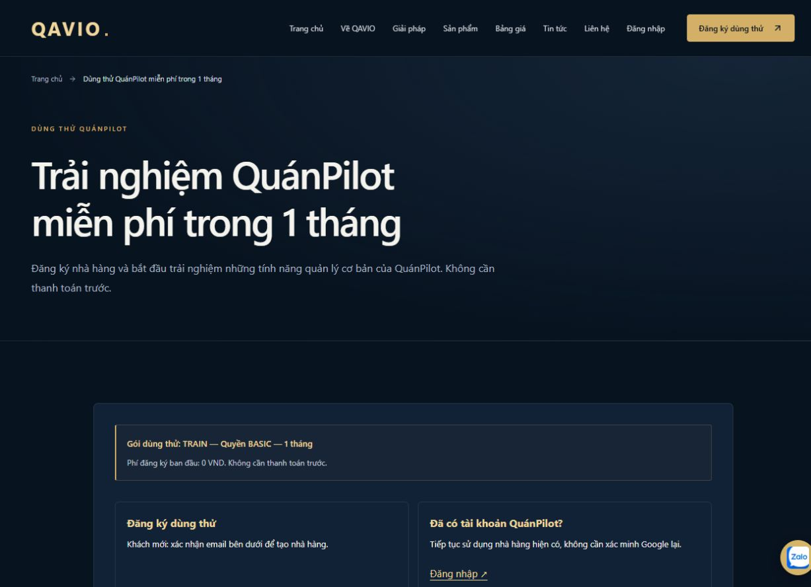
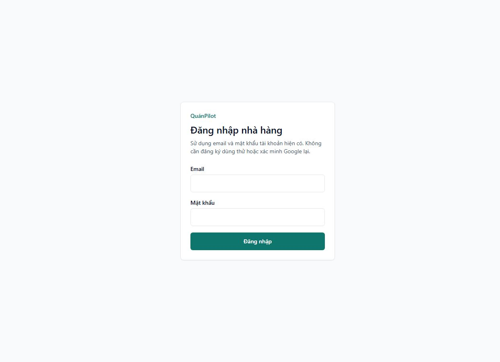

# QuánPilot — đăng nhập tài khoản hiện có

Ngày thực hiện: 21/10/2026. Phạm vi attachment943a7817. Đã triển khai production sau chỉ đạo tiếp theo “deloy”; xem kết quả phát hành bên dưới.

## Luồng

- QAVIO có liên kết Đăng nhập tại header desktop/mobile (và trang chủ qua header), footer và hai card trên `/trial` trước xác nhận Google.
- URL tập trung tại `site.quanpilotLoginUrl`: origin từ `QUANPILOT_PUBLIC_URL`, mặc định hostname đã được chủ dự án xác nhận `https://admin.qavio.site`, đường dẫn `/restaurant-login`.
- QAVIO chỉ điều hướng. Email/mật khẩu, cookie, session đều do NextAuth Credentials hiện có trên QuánPilot xử lý. Không có form mật khẩu QuánPilot, cookie chung domain hay lưu mật khẩu trên QAVIO.
- QuánPilot `/restaurant-login` hiển thị email/mật khẩu khi chưa có phiên; phiên hợp lệ chuyển theo membership. Callback cố định `/restaurant-entry` không nhận callback tùy ý từ query. Không đi vào Platform Admin qua entry này, kể cả tài khoản có platform role.
- Một membership hợp lệ đi vào luồng theo role hiện có; OWNER/MANAGER tới dashboard. Nhiều membership dùng `/select-restaurant` hiện có. Tenant guards hiện có vẫn kiểm tra quyền, trạng thái và gói. Tài khoản bị vô hiệu hóa hoặc đã xóa không được dùng JWT cũ để tiếp tục qua entry.
- Trang login tenant kiểm tra phiên và membership đúng slug trước khi bỏ qua form. Không chuyển sang tenant mà người dùng không thuộc về.
- Sau đăng ký trial, nút “Đăng nhập và bắt đầu sử dụng” dùng nguyên URL tenant thực tế mà API trả về; không hardcode slug.
- Không thêm Quên mật khẩu vì chưa có cơ chế thật. Không thay Google OAuth, TTL phiên, cookie settings, DB schema hoặc subscription.

## Kiểm thử

- QAVIO lint, TypeScript, production build đạt; public regression14trang/377liên kết, SEO/sitemap/404/logo đạt.
- QuánPilot lint, TypeScript và production build đạt. Build cuối dùng cấu hình DB test cô lập, không còn cảnh báo thiếu DATABASE_URL của lần chạy đầu.
- `Restaurant/scripts/restaurant-login-integration.ts` kiểm HTTP NextAuth thật trên loopback3200/DB `restaurant_trial_test`: anonymous, sai/đúng mật khẩu, còn phiên, login đúng slug, tenant khác bị chặn, nhiều membership, logout/relogin, token hết hạn, verification cookie không phải session. Đếm TrialRegistration/SubscriptionRequest/Entitlement không đổi. Fixture tự dọn đúng prefix UUID, không sửa quán Long Phụng.
- Regression trial22ca đạt: Google claims/nonce/audience/ownership, provisioning/idempotency, BASIC guards, quota/rate limit, rollback transaction và password login. Đây là adapter cô lập, không phải một lần đăng nhập Google thật mới. Dòng QA forced failure là ca rollback có chủ đích và đạt.
- Không gửi dữ liệu QA hoặc đăng nhập thử vào production. Không thay dữ liệu nhà hàng production.
- Browser: form email/mật khẩu QuánPilot và lỗi đăng nhập sai hiển thị đúng; QAVIO có hai card trước xác minh Google, menu mobile có Đăng nhập, Roboto đã áp dụng. Desktop1280 và mobile390 không tràn ngang; các URL đăng nhập đều trỏ hostname đã xác nhận. Kiểm thử HTTP chạy lại sau xử lý JWT trỏ tài khoản đã xóa/vô hiệu hóa và đạt. Phiên Google thật không cần xác minh lại vì không thay OAuth; regression dùng adapter nêu trên.

## Kế hoạch deploy và rollback

1. Build Linux bằng hai workflow dispatch hiện có ngoài VPS, kiểm tra SHA/image/checksum. Push Git không tự deploy vì workflows chỉ dispatch.
2. Kiểm tra dung lượng và health, giữ image đang chạy để rollback: QAVIOcf2a207, QuánPilot2e8d0b1. Không build nặng trên VPS, không prune chung hoặc xóa volume.
3. Phát hành QuánPilot trước để `/restaurant-login` và `/restaurant-entry` sẵn sàng. Smoke anonymous/session/tenant trên origin thật trước khi phát hành link QAVIO.
4. Phát hành QAVIO sau. Giữ mọi env/flags/contact/trial/mail/indexing hiện tại. Không migration, không đổi OAuth callback hay Nginx.
5. Nếu lỗi, rollback web QAVIO trước, rồi app QuánPilot về image cũ. PostgreSQL/worker/Restaurant data/Portfolio không recreate hoặc restore.

Bản nâng cấp hình ảnh đang làm riêng ở working tree, chưa được duyệt commit/deploy theo yêu cầu hình ảnh. Commit đăng nhập không bao gồm các file hình ảnh/CMS/font đó.

## Phát hành production đã hoàn tất

- QAVIO source/image `697a6a122d8fc5af301a23863bc4423916707f46` / `qavio-web:697a6a1`; [CI39591232625](https://github.com/herry-huynhlong/qavio/actions/runs/39591232625) success.
- QuánPilot source/image `be133f24d5f5134f96427b6683089765f2f13af2` / `quanpilot-app:be133f2`; [CI39591262589](https://github.com/herry-huynhlong/restaurant/actions/runs/39591262589) success.
- Hai commit chốt thêm reserved slug `restaurant-login`/`restaurant-entry` vào contract cả hai ứng dụng, kiểm DB production không có nhà hàng trùng trước phát hành. HTTP integration và trial22ca được chạy lại, đạt. Hai build Linux cuối đều đạt; không build VPS.
- Artifact ZIP/checksum archive/OCI manifest/config/rootfs/revision khớp image đã nạp và chạy. [Bằng chứng image và flags](login-release/deployment-proof.json).
- Backup mới hai DB và uploads/media được mã hóa, tải off-host và restore cô lập đạt5/27migration. SHA256 ciphertext `237c7936cc7792d14c6faa9d03743f111583f5f520b0bb7ed125be92f28aee10`; bản restore/plaintext đã dọn, giữ bản mã hóa. Không restore hoặc migration production.
- Cập nhật QuánPilot trước, xác nhận HTTPS origin `/restaurant-login` đúng, rồi recreate QAVIO. Chỉ thay image trong overlay app và QAVIO_IMAGE_TAG. So sánh toàn bộ runtime environment hai app trước/sau khớp; secrets, OAuth callback, flags và cookie cấu hình giữ nguyên.
- QAVIO web healthy; QuánPilot app Up và HTTP/NextAuth đạt. Hai PostgreSQL và worker QAVIO healthy. Worker Restaurant, PostgreSQL, worker QAVIO và Portfolio giữ nguyên ID/start/restart count; Portfolio HTTPS200. Không gán nhãn Docker healthy cho app QuánPilot vì service chưa có healthcheck Docker.
- Production HTTP14trang/HTTPS/canonical/noindex/link đăng nhập, `/restaurant-entry`307 về login khi anonymous, `/api/auth/session` rỗng, CSRF cookie Secure host-only, Admin anonymous401, CONTACT/DEMO422 với payload rỗng, QUOTE/newsletter503, trial session enabled đạt. Không gửi PII hoặc tạo QA production. [Kết quả public](login-release/public-smoke.json).
- Browser desktop1280 và mobile390 không tràn ngang; hai card xuất hiện trước xác minh Google, Google button enabled, header/mobile/card link tới đúng QuánPilot và form email/mật khẩu. Không có warn/error trình duyệt ở trang login. Phiên có mật khẩu đúng/sai/hết hạn/multi-tenant được nghiệm thu trên DB local cô lập; không dùng credential khách để đăng nhập production hoặc gọi lại Google OAuth thật trong lượt phát hành này.
- Disk ban đầu khoảng5.1GiB trống/79%; sau tải artifact, trước load image4,923,150,336bytes; sau deploy và dọn đúng hai archive đã nạp3,919,478,784bytes, `df -h`3.7G trống/85%. Không prune Docker hoặc xóa volume, rollback image, uploads hay cache chung.

### Link và rollback hiện tại

- Website/trial: https://qavio.site/trial ; tài khoản hiện có: https://admin.qavio.site/restaurant-login ; CMS QAVIO: https://qavio.site/admin/login . Dùng tài khoản/mật khẩu hiện có, không tạo credential mới.
- Snapshot private `/opt/websites/qavio/.runtime/login-release-20261021/snapshot` gồm QAVIO.env, production.env, overlay QuánPilot và cấu hình container trước release. Snapshot chứa secrets, không đưa vào Git/log.
- Rollback: khôi phục QAVIO `.env` và QuánPilot `.trial-runtime/production-release.yaml` từ snapshot; recreate riêng web QAVIO rồi app QuánPilot bằng image `qavio-web:cf2a207` và `quanpilot-app:2e8d0b1`. Hai image cũ còn trên VPS. Không thay Nginx hoặc restore DB. Production source image là hai SHA ở trên; commit tài liệu sau đó không cần rebuild.

