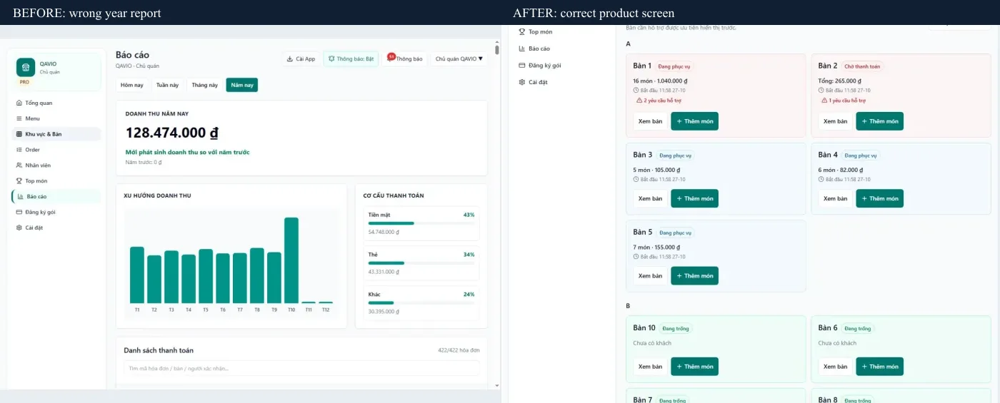
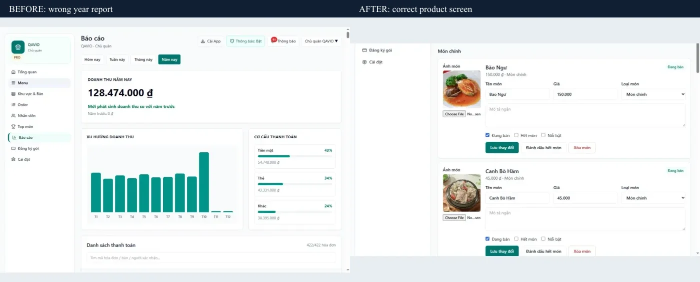

# Gallery và hướng dẫn cài QuánPilot — 28/10/2026

## Phạm vi và nguyên nhân

Hai file cũ `pro-tables.webp` và `pro-menu-admin.webp` chứa pixel của Báo cáo năm. Mapping đã dùng hai URL khác nhau; lỗi nằm ở ảnh được chụp trước khi điều hướng hoàn tất, không phải dùng chung một URL. Đã xem bằng mắt cả 26 nguồn ảnh, giữ 24 ảnh đúng và chụp lại hai màn hình từ clone PRO QAVIO cô lập, slug `thien-dao`. Không ghi dữ liệu vào production.

- Bàn: `pro-tables-v2-750c1150.webp`, 1180×900; khu vực A đang phục vụ/chờ thanh toán và B trống.
- Thực đơn: `pro-menu-admin-v2-acf11b28.webp`, 1165×709; danh mục Món chính, ảnh, giá, trạng thái và các thao tác thật. Crop vùng danh sách, không sửa nội dung hay số liệu.
- URL mới có hash tránh cache ảnh cũ. Hai file cũ không còn được mapping công khai sử dụng; giữ file lịch sử không đồng nghĩa ảnh cũ còn xuất hiện trong gallery.
- Kiểm tra production bằng transaction READ ONLY: không có ContentEntry cho `visual-tables-screen` và `visual-menu-admin-screen`; CMS không ghi đè hai slot này. Browser production xác nhận cả 26 nguồn khớp mapping.
- Bảng đầy đủ vai trò/tab/thiết bị/alt/caption/file/SHA256: [mapping.json](gallery-install/mapping.json). Test kiểm tra đúng 26 nguồn duy nhất và hash của các pixel đã review.

## Giao diện và kiểm thử local

- Thêm section giới thiệu cài ứng dụng từ website, ảnh giao diện thật, CTA dùng thử và `/products/quanpilot/install`.
- Hướng dẫn Android, Safari iPhone/iPad, Chrome/Edge desktop; giải thích tùy hỗ trợ, cần mạng, tên biểu tượng theo nhà hàng, có thể cần đăng nhập lại. Không tạo ảnh giả đã cài, không hứa offline/native store.
- 26/26 tab và lightbox trên desktop/mobile được kiểm tra nguồn ảnh; chụp trực tiếp viewport để đối chiếu. 26 bước Tiếp, 6 vòng Trước và chuỗi Năm → Bàn → Menu → Năm → Bàn đạt.
- 1440/1024/768/390/375px: không tràn ngang (client/scroll lần lượt 1425/1425, 1009/1009, 753/753, 375/375, 360/360; thanh cuộn chiếm 15px).
- Lint, TypeScript, production build: PASS. 14 trang/367 liên kết nội bộ, metadata/canonical/sitemap/404: PASS. CMS ảnh 14 ca trên `qavio_test`: PASS. Test gallery/guide: PASS.
- Những thay đổi Contact đang chờ nghiệm thu thuộc task trước được giữ local, không đưa vào commit/phát hành này.

## PWA production và giới hạn

- Manifest `/thien-dao/admin/manifest.webmanifest`: HTTP200, `display: standalone`, scope `/thien-dao/`, start URL đúng `/thien-dao/admin`, icon theo tenant. Service worker HTTP200; không có offline data cache.
- Phát hiện hai lỗi riêng QuánPilot: fallback Cài App luôn đưa hướng dẫn iPhone, kể cả desktop; icon PNG khai báo 192/512 nhưng production trả 227/605px. Nguyên nhân icon: nhiều resize trong một pipeline Sharp, chỉ resize cuối có hiệu lực trước extend.
- Đã chuẩn bị bản sửa local Restaurant: hướng dẫn theo thiết bị, xử lý prompt lỗi, dọn listener; render icon bằng hai pipeline và canvas kích thước chính xác. Test 7 trường hợp thiết bị và 6 trường hợp icon (ngang/dọc/nhỏ ×192/512) PASS; lint và TypeScript PASS. Báo cáo riêng `D:/anh/Restaurant/docs/PWA_INSTALL_AUDIT.md`.
- **Chưa phát hành Restaurant.** Không thay auth/session/OAuth/QR/order/payment/subscription/schema/dữ liệu. Cần nghiệm thu riêng bản PWA trước phát hành.
- Agent chỉ có Browser Codex, không có trình cài native Chrome/Android/iOS. Sau đó chủ dự án xác nhận **đã cài và mở app thành công**. Ghi nhận kiểm chứng do chủ dự án thực hiện; thiết bị/trình duyệt chưa cung cấp và session sau mở lại chưa được xác minh riêng. Không coi đây là kiểm thử của agent trên tất cả nền tảng.

## Phát hành QAVIO

**QAVIO đã phát hành thành công.**

- Source: `eaae2b41854c57d0d85f310d08873faa15f33ffa`.
- [Linux CI 40631943649](https://github.com/herry-huynhlong/qavio/actions/runs/40631943649): SUCCESS; [release review 40632262984](https://github.com/herry-huynhlong/qavio/actions/runs/40632262984): SUCCESS.
- Image: `qavio-web:eaae2b4`, ID `sha256:40aac20c462f5531d14a2ee5a98c1afc7c0642068443084e30e1f52ad2322c86`.
- Manifest SHA256: `323440a4abd6c35cdcd0dae3428591579994368c0ba4620b9b6d6e5bc83f4857`; GitHub artifact digest và image/config/rootfs/source SHA đều được xác minh. Chi tiết [artifact.json](gallery-install/artifact.json), [ci-review.json](gallery-install/ci-review.json).
- Backup QAVIO DB + media mới, mã hóa, off-host, restore cô lập PASS (5 migration). Không migration hoặc restore production. [backup-proof.json](gallery-install/backup-proof.json).
- Capacity trước: 5,147,684,864 byte trống, disk80.28%, memory available501,039,104 byte; gate dự trù4,758,053,273 byte PASS. Artifact gzip141,422,585 byte, image/unpacked383,805,952 byte; kiểm tra lại trước load PASS.
- Sau deploy: 4,601,470,976 byte trống (~4.29GiB), memory available556,990,464 byte; 7/7 container chạy, QAVIO web/worker và hai PostgreSQL healthy. Các container không có healthcheck không được gán giả nhãn healthy. Sáu container ngoài web QAVIO giữ nguyên ID/image/startedAt; env và mounts không đổi.
- Chỉ recreate service web bằng image ID đã xác minh, `--no-build --pull never --no-deps`. Không build VPS, không restart worker/PG/Docker, không xóa volume/backup/dữ liệu. Image archive được bỏ sau load theo runbook; giữ image rollback.
- Production: 26/26 asset hash PASS cả origin/HTTPS; 19 đường dẫn HTTPS PASS; 26/26 mapping browser PASS, hai ảnh mới xem trực quan đúng; lightbox Trước/Tiếp, mobile zoom/scroll, reload và guide PASS, console không có error. [origin-smoke.json](gallery-install/origin-smoke.json), [external-smoke.json](gallery-install/external-smoke.json), [browser-mappings.json](gallery-install/production/browser-mappings.json).
- CONTACT enabled; QUOTE/newsletter/email vẫn false. Login QuánPilot và public pricing HTTP200. Không gửi form QA, tạo giao dịch hoặc ghi dữ liệu Restaurant production.

## Ảnh đối chiếu và file sửa

Ảnh production: [bàn desktop](gallery-install/production/tables-desktop.jpg), [thực đơn desktop](gallery-install/production/menu-desktop.jpg), [bàn mobile](gallery-install/production/tables-mobile.jpg), [section cài ứng dụng](gallery-install/production/install-desktop.jpg), [hướng dẫn mobile](gallery-install/production/guide-mobile.jpg).

Source QAVIO sửa: `product-demo-visuals.ts`, `product-demo-gallery.tsx` (export cấu hình phục vụ kiểm thử), `marketing-product.tsx`, `product-install-section.tsx`, `visual.css`, `site-config.ts`, route `products/quanpilot/install/page.tsx`, `check-public-pages.mjs`, `gallery-install-checks.ts`, workflow `qavio-release.yml`, hai asset version mới và tài liệu/bằng chứng. Không đổi component Contact đang chờ phát hành.

## Rollback

Giữ image cũ `qavio-web:40ea03d`, ID `sha256:4e8f2f2f71b18214745b6c2c0c5fd2d5668764189375da8bb862e90a9a3ba5e6`. Snapshot cấu hình/env và model image-only rollback được bảo vệ tại `/opt/websites/qavio/.runtime/gallery-install-release-20261028/snapshot/`.

Khi cần rollback, khôi phục `.env` từ `snapshot/environment.private`, chạy Compose project qavio với `snapshot/rollback.private.json`, `up -d --no-build --pull never --no-deps web`, rồi kiểm tra readiness/HTTPS. Không restore database để đảo thay đổi code. Không đưa các file private snapshot vào Git/log.

Production build QuánPilot trên clone PASS; HTTP icon sửa trả192/512 đúng và browser fallback desktop PASS. Bản sửa PWA vẫn local, chưa phát hành Restaurant.
