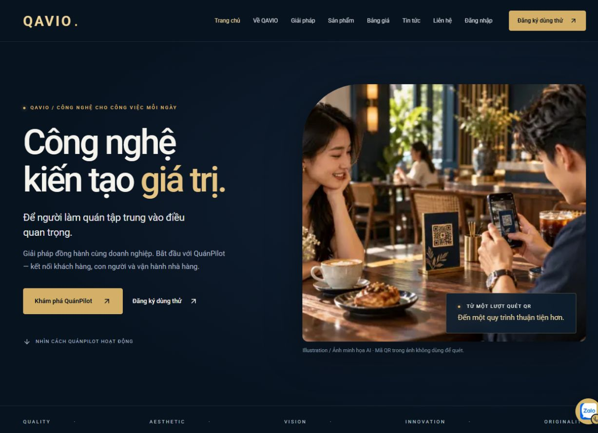
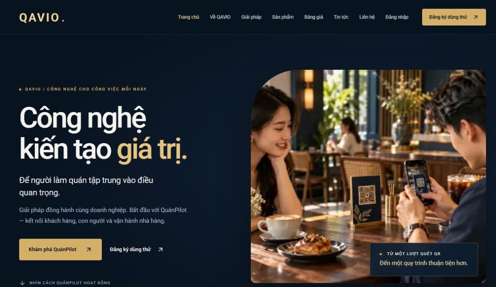

# Tinh chỉnh marketing QAVIO và layout bàn QuánPilot

21/10/2026 — yêu cầu31440fd2, đã có phê duyệt trực tiếp commit/push/deploy sau kiểm thử; không chờ xác nhận lại.

## Thay đổi QAVIO

- `src/lib/visuals.ts`, `src/server/visuals.ts`: caption theo ngữ cảnh thay chú thích kỹ thuật; caption CMS cũ có nhãn kỹ thuật được chuẩn hóa khi đọc, không UPDATE dữ liệu. Origin AI/SCREENSHOT/PHOTO vẫn lưu trong CMS/metadata và tài liệu nguồn; không khẳng định ảnh minh họa là khách hàng/nhân sự QAVIO thật hay QR trong ảnh có thể quét.
- `visual-media.tsx`: bỏ prefix Illustration/QuánPilot, cho phép ẩn caption dư. Nguồn ảnh giữ ở data-image-origin.
- `marketing-home.tsx`, `marketing-product.tsx`, `product-explorer.tsx`: bỏ nhãn BASIC/PRO ở card/khối giới thiệu vai trò, giảm caption trùng, dùng mô tả lợi ích. Không sửa ảnh/logo. Giữ các vai trò và điều hướng.
- `restaurant-flow.tsx`: tiêu đề “Quy mô sản phẩm”, mô tả đúng nội dung chủ dự án yêu cầu, giữ sáu bước và link đến thông tin quyền gói.
- `visual.css`: card theo cột, CTA thẳng hàng, chiều cao ảnh nhất quán.
- `/pricing`, `trial-form.tsx`: nêu rõ TRAIN/BASIC và màn hình bếp/thu ngân/vai trò quản lý thuộc PRO tại nơi lựa chọn gói/dùng thử; FAQ phạm vi trên trang sản phẩm vẫn đúng. Không sửa auth/OAuth/API/form submission hoặc quyền backend.

## Kiểm thử

- Lint, TypeScript, production build QAVIO và QuánPilot đạt. Public regression14trang/379liên kết, SEO/sitemap/404/logo đạt. CMS ảnh13ca đạt; đăng nhập/session/tenant và trial22ca đạt trên DB cô lập.
- Browser local375px: home/product/solutions/pricing/trial không tràn, không còn caption kỹ thuật hoặc badge trong card marketing. Pricing/trial vẫn có giải thích quyền PRO. Desktop1280px ba CTA vai trò cùng vị trí đáy2987.27px. [Số đo](marketing-refinement/responsive.json).
- QuánPilot được thử tại320/375/768/1024/1440px và tạo khu vực/chọn khu vực/tạo bàn thực sự trên QA riêng. Chủ dự án duyệt sửa thêm lỗi redirect có sẵn; chi tiết và trước/sau tại Restaurant/docs/TABLE_LAYOUT_REFINEMENT.md.
- Không migration, không sửa dữ liệu nhà hàng hiện có/production, không tạo ảnh mới. Source metadata và prompt gốc vẫn giữ.

## Phát hành

Đang chuẩn bị commit/image CI hai repository. Build ngoài VPS; backup/snapshot và giữ rollback3c22501/be133f2. Chỉ recreate web/app, không worker/DB/Portfolio; không đổi env/flags. Bằng chứng production cập nhật sau deploy.

