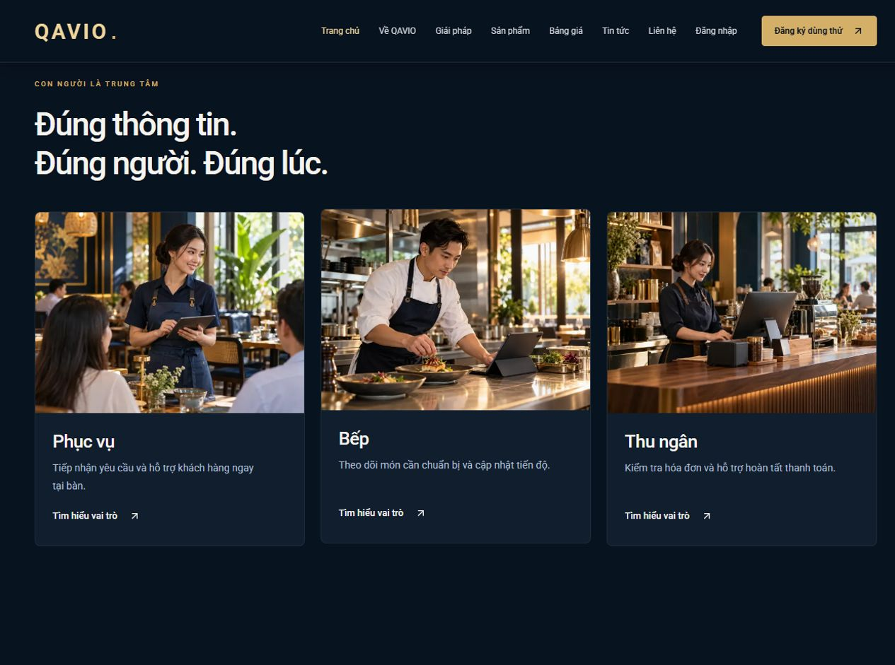

# Tinh chỉnh marketing QAVIO và layout bàn QuánPilot

21/10/2026 — yêu cầu31440fd2, đã có phê duyệt trực tiếp commit/push/deploy sau kiểm thử; không chờ xác nhận lại.

## Thay đổi QAVIO

- `src/lib/visuals.ts`, `src/server/visuals.ts`: caption theo ngữ cảnh thay chú thích kỹ thuật; caption CMS cũ có nhãn kỹ thuật được chuẩn hóa khi đọc, không UPDATE dữ liệu. Origin AI/SCREENSHOT/PHOTO vẫn lưu trong CMS/metadata và tài liệu nguồn; không khẳng định ảnh minh họa là khách hàng/nhân sự QAVIO thật hay QR trong ảnh có thể quét.
- `visual-media.tsx`: bỏ prefix Illustration/QuánPilot, cho phép ẩn caption dư. Nguồn ảnh giữ ở data-image-origin.
- `marketing-home.tsx`, `marketing-product.tsx`, `product-explorer.tsx`: bỏ nhãn BASIC/PRO ở card/khối giới thiệu vai trò, giảm caption trùng, dùng mô tả lợi ích. Không sửa ảnh/logo. Giữ các vai trò và điều hướng.
- `restaurant-flow.tsx`: tiêu đề “Quy mô sản phẩm”, mô tả đúng nội dung chủ dự án yêu cầu, giữ sáu bước và link đến thông tin quyền gói.
- `visual.css`: card theo cột, CTA thẳng hàng, chiều cao ảnh nhất quán.
- `/pricing`, `trial-form.tsx`: nêu rõ TRAIN/BASIC và màn hình bếp/thu ngân/vai trò quản lý thuộc PRO tại nơi lựa chọn gói/dùng thử; FAQ phạm vi trên trang sản phẩm vẫn đúng. Không sửa auth/OAuth/API/form submission hoặc quyền backend.

## Kiểm thử

- Lint, TypeScript, production build QAVIO và QuánPilot đạt. Public regression14trang/379liên kết, SEO/sitemap/404/logo đạt. CMS ảnh13ca đạt; đăng nhập/session/tenant và trial22ca đạt trên DB cô lập.
- Browser local375px: home/product/solutions/pricing/trial không tràn, không còn caption kỹ thuật hoặc badge trong card marketing. Pricing/trial vẫn có giải thích quyền PRO. Desktop1280px ba CTA vai trò cùng vị trí đáy2987.27px. [Số đo](marketing-refinement/responsive.json).
- QuánPilot được thử tại320/375/768/1024/1440px và tạo khu vực/chọn khu vực/tạo bàn thực sự trên QA riêng. Chủ dự án duyệt sửa thêm lỗi redirect có sẵn; chi tiết và trước/sau tại Restaurant/docs/TABLE_LAYOUT_REFINEMENT.md.
- Không migration, không sửa dữ liệu nhà hàng hiện có/production, không tạo ảnh mới. Source metadata và prompt gốc vẫn giữ.

## Phát hành

Đã push và deploy cả hai ứng dụng. Build Linux ngoài VPS; backup/snapshot và giữ rollback3c22501/be133f2. Chỉ recreate web/app, không worker/DB/Portfolio; toàn bộ runtime env và flags trước/sau khớp.

### Kết quả production

- QAVIO image `qavio-web:7ebeb22`, SHA `7ebeb22dfadad34c9aa175d370c5ada0bcffb97d`, [CI39601339711](https://github.com/herry-huynhlong/qavio/actions/runs/39601339711) success.
- QuánPilot image `quanpilot-app:05ff9ad`, SHA `05ff9ad0d1d102ee5d2d2a4e8db9839e951e1b48`, [CI39601344608](https://github.com/herry-huynhlong/restaurant/actions/runs/39601344608) success.
- Kiểm checksum ZIP/archive, OCI manifest/config/layers/revision khớp image đang chạy. Đã dọn ngay archive riêng sau khi nạp và xác minh từng image để giảm đỉnh sử dụng disk; không prune image/volume/cache chung. [Proof](marketing-refinement/deployment-proof.json).
- Backup mới hai DB/media/uploads được mã hóa và tải off-host; restore disposable5/27migration đạt, bản restore/plaintext đã dọn. Ciphertext SHA256 `530ecbcb0631f4b5018ff9cc2f29daf9b7d86df9f557e1264e9a58186d276e35`. Không migration hay restore production.
- HTTP production6trang marketing đạt: không caption kỹ thuật/nhãn gói card, “Quy mô sản phẩm” đúng, origin metadata vẫn có, pricing/trial giải thích quyền đúng; trang quản lý bàn anonymous307 về login. Hồi quy14trang/HTTPS/API/cookie/contact/trial đạt. [Public smoke](marketing-refinement/public-smoke.json).
- Browser production desktop1280 và6trang tại375px: không tràn ngang, không caption kỹ thuật/role badge; console không warn/error. [Số đo production](marketing-refinement/production-responsive.json). Tạo khu vực/bàn, chọn khu vực và success/duplicate đã kiểm bằng browser/DB QA riêng; không tạo QA hoặc dùng credential khách để thao tác bàn production. Phiên QA đã logout, fixture đã dọn.
- Web QAVIO healthy; app QuánPilot Up và HTTP/NextAuth đạt. Hai PostgreSQL và worker QAVIO healthy; maintenance worker và Portfolio giữ nguyên ID/start/restart count. PortfolioHTTPS200. Contact/DEMO và trial vẫn mở; quota100, email/QUOTE/newsletter/indexing vẫn đóng.
- Disk trước3.5G/86%, sau2,250,850,304bytes (`df -h`2.1G/91%). Giữ cả image rollback3c22501/be133f2 và mọi dữ liệu. Dung lượng còn hạn chế, chưa xóa các image cũ khác trong lượt UI này.
- Snapshot private `/opt/websites/qavio/.runtime/refinement-release-20261021/snapshot`. Nếu cần rollback, khôi phục QAVIO `.env` và overlay QuánPilot từ snapshot; recreate riêng web QAVIO rồi app QuánPilot bằng3c22501/be133f2, không restore DB hoặc sửa Nginx/worker. Snapshot chứa secrets, không đưa vào Git/log. Các commit chỉ cập nhật báo cáo sau image không cần rebuild.

