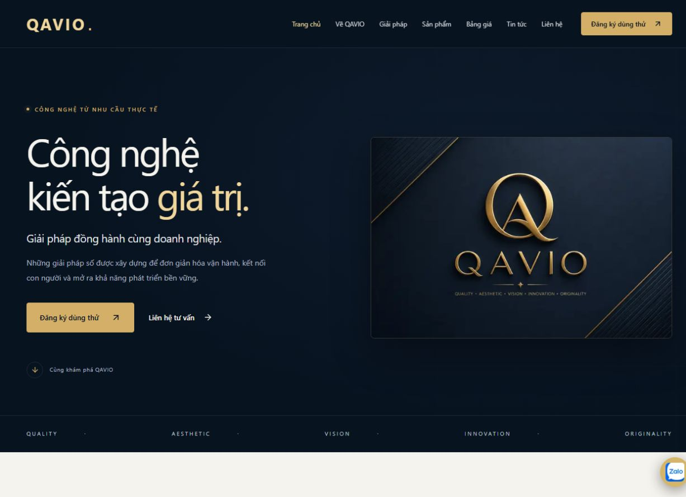
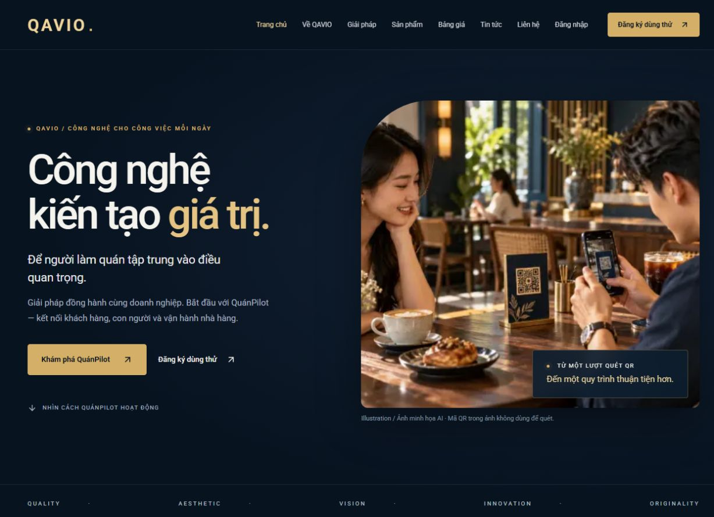
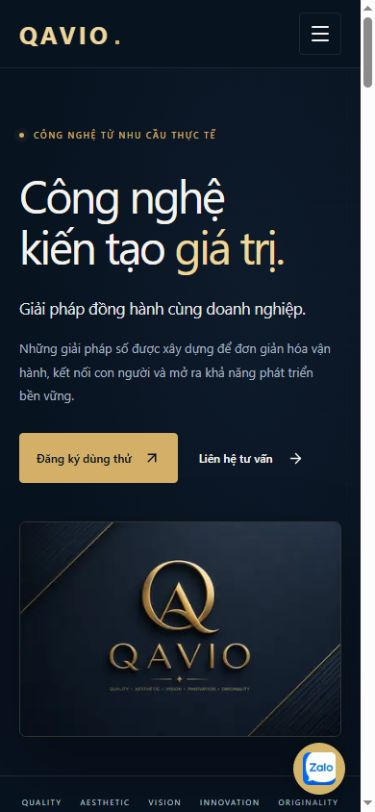
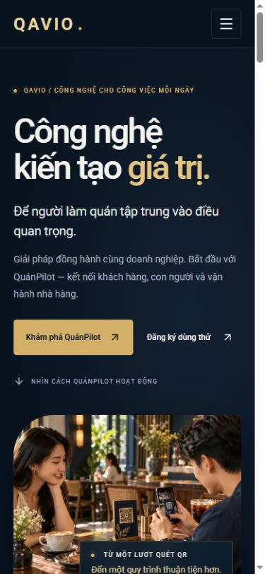
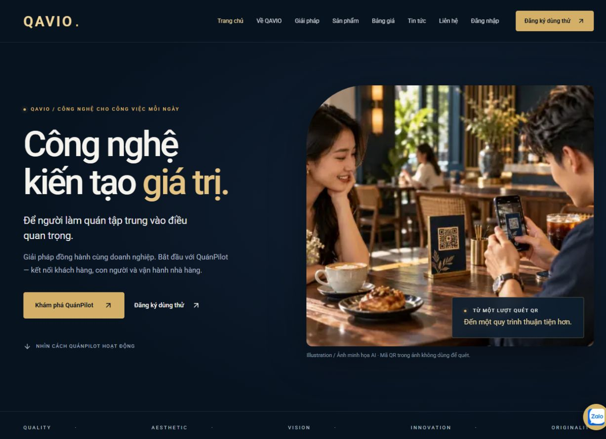
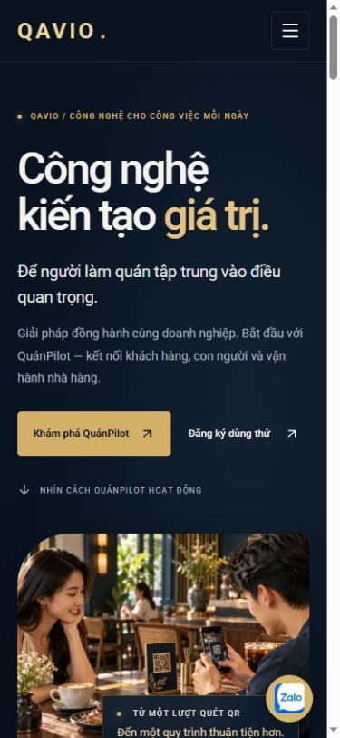

# Nâng cấp hình ảnh QAVIO — 21/10/2026

Trạng thái: đã push và deploy toàn bộ giao diện/CMS ảnh/Roboto sau chỉ đạo “ủa sao ở local? push lên đi”. Production đã kiểm tra đạt; xem kết quả phát hành bên dưới. Bảy screenshot chức năng chưa có giữ ẩn, bổ sung sau qua CMS.

## Đánh giá trực tiếp trước khi sửa

Đã truy cập bằng trình duyệt thật cả bảy URL production: /, /solutions, /products, /products/quanpilot, /pricing, /trial, /about trên desktop và mobile. Các trang solutions/products/quanpilot/pricing/trial không có ảnh nội dung, home/about chỉ có ảnh thương hiệu. Trang QuánPilot có tám nhóm tính năng chủ yếu bằng chữ; Solutions lặp lại ba nhãn cho mỗi hướng tiếp cận. Không thấy tràn ngang ở mobile390px. Homepage còn thông báo kênh tư vấn đang chuẩn bị mặc dù intake đã mở.

Ảnh trước/sau và các bằng chứng kiểm tra nằm trong `.runtime/visual-upgrade/` (ignored). Bản trước là production, bản sau là production build local với cấu hình test riêng.

## Bố cục và các trang nâng cấp

- Trang chủ: hero ảnh quét QR, CTA khám phá sản phẩm/dùng thử, ảnh QR lớn, sáu bước vận hành, ba vai trò, góc nhìn chủ quán kèm dashboard thật, tư duy giải pháp, logo gốc và FAQ/CTA cuối.
- QuánPilot: hero ảnh, quy trình thực tế, sáu section xen kẽ ảnh/chữ cho khách/phục vụ/bếp/thu ngân/chủ quán/bàn-thực đơn-nhân sự; giữ nội dung sản phẩm đã xuất bản từ CMS và FAQ. Tabs vai trò có ảnh, điều khiển bằng bàn phím; screenshot có lightbox native dialog.
- Solutions: bốn câu chuyện bằng ảnh và đoạn ngắn, giữ rõ đây là hướng tiếp cận, không tự nhận dịch vụ chưa triển khai.
- Products: hero ảnh và slot mockup menu thật; giữ danh sách sản phẩm CMS và phân trang, bổ sung ảnh cho tabs.
- About: đồ họa công nghệ, giữ logo chính thức, mission/vision/values và nội dung CMS; không tạo đội ngũ/trụ sở/thành tích giả.
- Pricing: hero chủ quán, card BASIC/PRO rõ hơn, giữ nguyên nội dung giá/thời hạn đã có; không tự thêm mức giá hoặc ma trận quyền thương mại.
- Trial: ảnh giới thiệu cùng thiết kế; giữ nguyên TrialForm, endpoint Google, validation và luồng đăng ký. Không chỉnh sửa source auth/trial/provisioning/payment của hai ứng dụng.

Giữ navy/vàng kim. Theo chỉ đạo tiếp theo của chủ dự án, dùng Roboto quen thuộc trên Android thay Segoe UI của Windows. Font tự host, có subset tiếng Việt/Latin/Latin extended, `font-display:swap`; không gọi Google Fonts khi khách mở trang. File/font license tại `public/fonts/`, CSS tại `src/app/fonts.css`.

## Bộ ảnh và quyền sử dụng

|File trong public/images/qavio|Nguồn|Kích thước|Dung lượng|
|---|---|---|---|
|qr-cafe.webp|AI riêng cho dự án, công cụ image_gen|1600×900|123612 bytes|
|service.webp|AI riêng cho dự án|1200×900|78248 bytes|
|kitchen.webp|AI riêng cho dự án|1200×900|98256 bytes|
|cashier.webp|AI riêng cho dự án|1200×900|99378 bytes|
|owner.webp|AI riêng cho dự án|1200×900|87082 bytes|
|tables.webp|AI riêng cho dự án|1200×900|144714 bytes|
|technology.webp|AI riêng cho dự án|1600×900|61716 bytes|
|dashboard-qa.webp|Ảnh chụp QuánPilot thật từ lượt QA local trước, giữ nguồn tham khảo|360×780|25318 bytes|
|dashboard-desktop.webp|Screenshot thật do chủ dự án cung cấp, cắt bỏ tên tài khoản|970×822|40810 bytes|

Ảnh AI do công cụ tích hợp tạo mới từ prompt của nhiệm vụ này; không tải ảnh Google/stock không rõ giấy phép, không watermark/thương hiệu khác, không sửa logo QAVIO. Đây là nguồn ảnh do AI tạo theo điều kiện sử dụng của công cụ, không tuyên bố là ảnh chụp khách hàng/nhân viên/trụ sở thật hoặc độc quyền bản quyền. Các chú thích HTML nêu rõ minh họa AI, QR trong ảnh không hoạt động. Không tạo UI phần mềm trong ảnh AI.

Prompt đầy đủ: `docs/VISUAL_IMAGE_PROMPTS.json`. PNG gốc giữ ngoài repository/build context trong `C:/Users/LONG_IT/.codex/generated_images/01a15707-ddbb-75a1-ab2c-b36e31c3fa68/`; bản WebP được tối ưu bằng Sharp, tổng ảnh 759.134bytes (khoảng0.76MB) trước Next Image responsive. Hero eager/high priority, các ảnh dưới fold lazy; width/height và aspect-ratio dành trước không gian. Chữ là HTML, không dán chữ quảng cáo vào ảnh.

Roboto lấy từ CSS chính thức https://fonts.googleapis.com/css2?family=Roboto:wght@400;500;600;700&display=swap và font binary fonts.gstatic.com. Giấy phép SIL Open Font License1.1 lưu nguyên tại public/fonts/Roboto-OFL.txt, nguồn https://github.com/google/fonts/tree/main/ofl/roboto . Không đổi tên/thay logo thương hiệu.

## Screenshot phần mềm thật

Đã kiểm tra ảnh `.runtime/trial-evidence/quanpilot-owner-basic.png` từ nghiệm thu local trước: Dashboard di động quán QA, dữ liệu tổng hợp, TRAIN/BASIC, doanh thu0. Không có email, điện thoại, token, mật khẩu hoặc đơn hàng khách thật. Chỉ chuyển định dạng sang WebP, không chế UI. Ảnh mobile cũ giữ làm nguồn tham khảo. Dashboard mặc định hiện dùng ảnh desktop chủ dự án cung cấp như ghi nhận dưới đây.

Các ảnh menu, giỏ hàng, quản lý bàn, phục vụ, bếp, thu ngân và báo cáo chưa được chụp trong lượt này. Chủ dự án xác nhận dùng Chrome riêng và sẽ gửi screenshot; không yêu cầu đăng nhập lại trong Codex. Đã nhận một dashboard desktop. Không giả danh tài khoản, tự cấp phiên, tạo đơn/bàn/món hoặc đổi gói chỉ để chụp ảnh. Riêng tác vụ hình ảnh không thay source/database Restaurant. Các slot thiếu ảnh không render ảnh màn hình giả; khi có ảnh thật có thể upload và publish từ CMS.

Đã đọc source quyền `Restaurant/src/lib/plan/features.ts`: TRAIN mặc định BASIC; phục vụ/BILL_PRINT/REPORTS thuộc BASIC, các vai trò MANAGER/KITCHEN/CASHIER và flow bếp/thu ngân riêng thuộc PRO. Gắn nhãn PRO rõ ở các section, tab và screenshot tương ứng; không hứa dùng thử BASIC có PRO. Muốn chụp màn hình PRO cần môi trường demo PRO có sẵn được phép truy cập, không nâng quyền quán QA.

## Dashboard do chủ dự án cung cấp

Ảnh đính kèm4ba7b3b8 là dashboard desktop QuánPilot thật. Chỉ cắt hình chữ nhật x304/y99/970×822 để bỏ topbar có tên tài khoản và sidebar; chuyển WebP86%, không AI chỉnh sửa, không thay số liệu hay gói. Ảnh được kiểm tra trực quan và dùng mặc định ở homepage, trang sản phẩm và tab Chủ quán. Khung desktop giữ tỷ lệ970:822, lightbox hiển thị lớn; không đóng khung điện thoại cho ảnh desktop. Không nhận định nội dung ngoài phần nhìn thấy là dữ liệu giả hay sản phẩm chính thức mới.

Sau thay ảnh: browser lightbox mở/đóng đạt, homepage/product/trial tại320px đều mộtH1 và không tràn ngang; home390px và1280px đạt, ảnh không kéo giãn. Console trang chủ không có warn/error. Ảnh trước/sau đã cập nhật. Bảy screenshot chức năng khác vẫn chờ chủ dự án gửi, không thay bằng UI AI.

## CMS quản lý ảnh

Route `/admin/visuals`, menu “Ảnh giới thiệu sản phẩm”:17 vị trí gồm9 ảnh bối cảnh/hero và8 screenshot. Dùng MediaAsset, ContentEntry, ContentRevision và AuditLog hiện có; không migration. Ảnh live và bản nháp dùng hai ContentEntry COMPANY riêng theo vị trí, không ảnh hưởng nội dung COMPANY/about hay media cũ.

Upload re-encode/giới hạn5MB/quota/auth/CSRF vẫn qua API media hiện có. Có preview, chọn ảnh thư viện, alt, chú thích/phạm vi gói, nguồn ảnh, lưu nháp, xuất bản. EDITOR được lưu nháp; chỉ ADMIN/SUPER_ADMIN xuất bản. Các slot screenshot yêu cầu nguồn SCREENSHOT. Backend xác thực slot, UUID, phiên bản draft/live, quyền publish, lưu revision và audit; không tin status từ frontend. Endpoint GET/PATCH `/api/admin/visuals` không công khai. Draft không thay live; public chỉ đọc live. Ảnh không được xuất bản vẫn cần authentication. Không xây page builder.

## Kiểm thử đã đạt

- Lint, TypeScript và production build local Windows PASS.
- Public regression14trang,377 liên kết nội bộ, metadata/canonical/OG/structured data, sitemap/404/logo gốc PASS.
- Admin31, Contact14, CMS ảnh13ca trên PostgreSQL qavio_test cô lập PASS. CMS gồm anonymous/CSRF/origin, EDITOR cấm publish, dữ liệu screenshot, private draft, optimistic version, publish/replacement, revision/audit.
- Origin checks và vòng đời polling chuông PASS. Contact/CRM/bell được giữ qua suite; không sửa SMTP/newsletter/trial/auth logic.
- Responsive35 tổ hợp:7trang ×320/375/390/768/1280px, xác minh innerWidth thực tế,1H1 và không tràn ngang. Lượt kiểm tra kích thước ban đầu gặp viewport của tab nền chưa đổi; đã loại bằng chứng đó và chạy lại trên tab được chọn với kích thước thực tế khớp.

Lighthouse13.5.0 chạy Chrome headless riêng trên production build local, mobile throttling mặc định, không dùng điểm production cũ: lượt đầu homepage Performance90, Accessibility100, Best Practices100, SEO69; LCP1.7s, CLS0.001. SEO bị trừ do noindex theo chỉ đạo đang có, không tự bật indexing để tăng điểm. Kết quả này phụ thuộc máy/mạng và môi trường local; không phải cam kết điểm production. Kết quả cuối và nghiệm thu UI CMS được bổ sung dưới đây.

## Git/deployment và phần còn lại

Toàn bộ thay đổi hình ảnh/CMS/font đã commit/push và phát hành image3c22501. Chỉ web QAVIO được recreate, không build VPS hoặc migration. QuánPilot giữ imagebe133f2 và container hiện có; runtime env/flags không đổi.

Bảy screenshot chức năng còn thiếu có thể bổ sung sau bằng CMS. Chủ dự án đã phê duyệt phát hành bản giao diện hiện có; không chờ đủ hình và không yêu cầu lại quyền commit/push/deploy. Không tạo UI giả thay cho các screenshot thiếu.

## Nghiệm thu cuối của phần đã triển khai

Build cuối sau khi bổ sung dashboard thật và tránh widget che form đã PASS; lint và TypeScript PASS. Test CMS ảnh13ca được chạy lại và đạt. Public14trang/377liên kết đạt trên build này. Phần hình ảnh không thay server/trial, lead-service hoặc schema Prisma. TrialForm và các route đăng nhập Restaurant được sửa riêng theo yêu cầu đăng nhập mới, xem docs/EXISTING_ACCOUNT_LOGIN.md. Không đưa Lighthouse vào dependency sản phẩm hoặc thay lockfile gốc; công cụ audit nằm trong runtime ignored.

Browser E2E local đã thực hiện upload ảnh mới → preview → lưu nháp → xác minh homepage vẫn dùng QR cũ → xuất bản → homepage đổi sang media vừa chọn; revision/audit được xác nhận trong DB test. Lightbox dashboard mở/đóng, focus trả về đúng nút mở. Menu mobile mở/đóng, Google button enabled trong cấu hình hiện tại; form tạo quán giữ disabled trước xác minh Google. Không kích hoạt Google start/provisioning để tránh tạo challenge/nhà hàng mới ở database QuánPilot chỉ vì tác vụ hình ảnh.

Form CONTACT local đã gửi một yêu cầu tổng hợp: đúng1Lead,0outbox, chuông Admin hiển thị yêu cầu mới. Các fixture Admin/CMS/media/contact/lead của lượt test đã dọn, phiên QA đã logout. Không xóa quán Long Phụng hoặc các file upload của chủ dự án. Server preview QAVIO3100, QuánPilot QA3200 và PG test55432 tiếp tục chạy loopback để chủ dự án xem và đăng nhập QA; không có truy cập VPS trong lượt này.

Nút liên hệ nổi được bổ sung quan sát vùng nhìn: trên mobile tự ẩn khi form/khối xác minh hoặc CTA cuối nằm trong vùng nhìn, trở lại khi rời form. Browser đã kiểm tra tại390px với cấu hình contact tổng hợp: form hiện → widget hidden; rời form → widget trở lại; Zalo không có URL nên không hiện. Thao tác này không thay đổi cấu hình kênh hoặc dữ liệu production.

Sau khi thêm khung hiển thị dashboard, kiểm tra lại homepage và trang QuánPilot ở cả5kích thước320/375/390/768/1280px vẫn không tràn ngang. Các số đo lấy từ innerWidth thực tế, không chỉ dựa vào kích thước yêu cầu của công cụ.

### Lighthouse sau khi dọn CMS thử, trước bổ sung link đăng nhập và dashboard desktop

|Trang/chế độ|Performance|Accessibility|Best Practices|SEO|LCP|CLS|
|---|---:|---:|---:|---:|---:|---:|
|Home/mobile|85|100|100|69|3.8s|0|
|QuánPilot/mobile|88|100|100|69|3.5s|0|
|Home/desktop|100|100|100|69|0.7s|0.004|

Đây là số đo local với CPU/network mô phỏng của Lighthouse, không phải điểm production. Giữ nguyên noindex nên SEO69 có nguyên nhân được biết; không bật indexing để sửa điểm. Mobile còn khoảng trễ render ảnh LCP trong mô phỏng chậm, chưa tuyên bố đạt90+ hoặc Core Web Vitals production. Ảnh hero đã high fetch priority/eager, discovery audit đạt; image-delivery audit không báo bytes lãng phí, tổng tải homepage đo được khoảng415KiB. Có thể tối ưu thêm sau khi đủ bộ screenshot, không thay chất lượng ảnh hoặc bỏ chức năng chỉ để làm đẹp điểm.

Tóm tắt số đo có thể mang theo repository: [lighthouse-summary.json](visual-upgrade/lighthouse-summary.json). Full audit và35+10tổ hợp responsive ở `.runtime/visual-upgrade/`.

### So sánh trước/sau

Cùng viewport desktop1280×900 và mobile390×844. Ảnh “trước” lấy từ production chưa sửa; ảnh “sau” từ build local, sau khi đã dọn ảnh xuất bản QA.

Trước — desktop:

Sau — desktop:

Trước — mobile:

Sau — mobile:

## Kết quả phát hành production

- Source `3c22501b46b6523f60e98b84620c90f0702922e4`, image `qavio-web:3c22501`. [CI39593104588](https://github.com/herry-huynhlong/qavio/actions/runs/39593104588) success: lint/type/build và các integration Admin/Contact/CMS ảnh13ca trên PostgreSQL cô lập đạt. Build Linux ngoài VPS.
- Đã xác minh SHA256 artifact ZIP/archive, OCI manifest/config/rootfs/revision và image đang chạy. [Proof image/flags/container](visual-upgrade/deployment-proof.json).
- Backup mới mã hóa hai DB và media/uploads, tải off-host và restore cô lập5/27migration PASS. Ciphertext SHA256 `b3ae476919042bb4b7fce5759c932531e10bb84ff9e12a4b99cef57e53d34787`. Bản restore/plaintext đã dọn; giữ backup mã hóa. Không migration/restore DB production.
- Chỉ recreate `qavio-web-1`, healthy. So toàn bộ environment trước/sau khớp; không đổi secrets hoặc flags. Worker QAVIO, hai PostgreSQL, QuánPilot, maintenance worker và Portfolio giữ nguyên ID/start/restart count. PortfolioHTTPS200. Contact/DEMO và trial vẫn mở; quota100; email/QUOTE/newsletter/indexing vẫn đóng.
- HTTP production7trang nâng cấp có ảnh,9WebP/759134bytes và3font Roboto tải200; dashboard thật hiển thị, private CMS ảnh anonymous401/login redirect307. HTTP hồi quy14trang, API/HTTPS/cookie/login entry/contact/trial đạt. [Kết quả ảnh/font](visual-upgrade/public-smoke.json).
- Browser production: font-family Roboto, hero tải thành công, dashboard lightbox mở/đóng; home desktop1280px không tràn. Bảy trang tại390px đều mộtH1/không tràn; console không warn/error. [Số đo mobile](visual-upgrade/production-responsive.json). Không tạo/sửa nội dung hoặc nhận PII thử trên production; CMS draft/publish đã kiểm local và CI, không dùng mật khẩu khách để nghiệm thu CMS production.
- Disk trước lượt này3.7G trống/85%; sau deploy và dọn đúng archive riêng của release3,706,843,136bytes, `df -h`3.5G/86%. Không prune Docker, xóa volume, uploads hay rollback image.
- Rollback giữ `qavio-web:697a6a1`. Snapshot private `/opt/websites/qavio/.runtime/visual-release-20261021/snapshot`; khôi phục `.env` từ `qavio.env` rồi recreate riêng web bằng ba Compose file hiện có. Không restore DB, không sửa Nginx hoặc QuánPilot. Snapshot có secrets, không đưa vào Git/log. Commit báo cáo sau3c22501 không yêu cầu rebuild.

Website thật: https://qavio.site . Quản lý ảnh: https://qavio.site/admin/visuals . Bảy slot screenshot chức năng chưa có tiếp tục ẩn, có thể bổ sung từ CMS sau.

